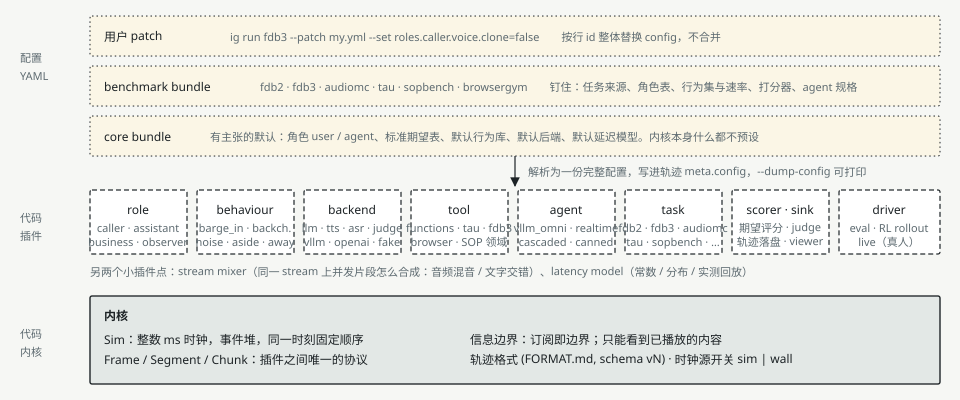
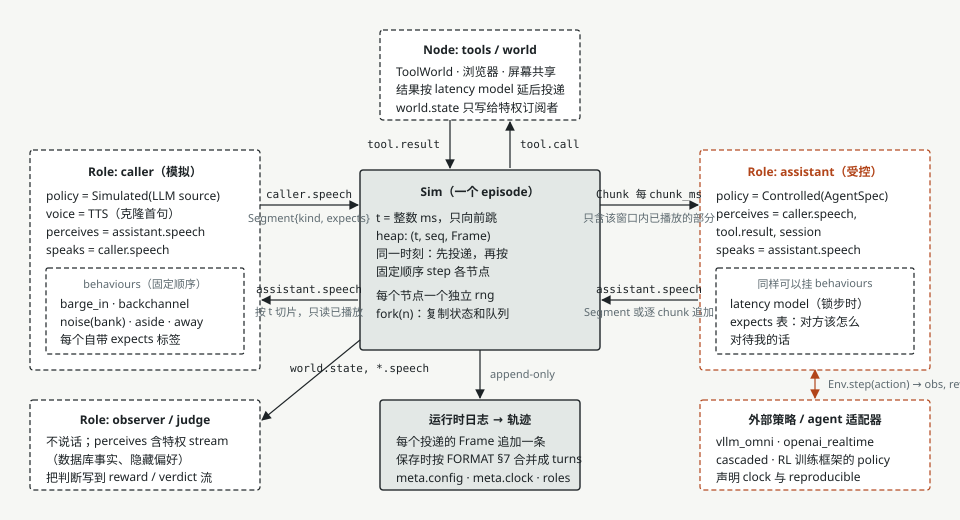
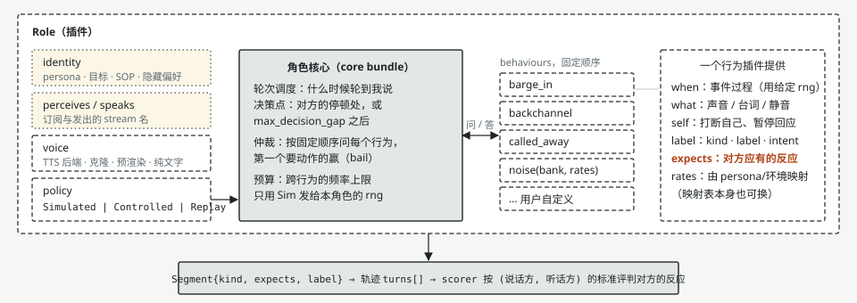
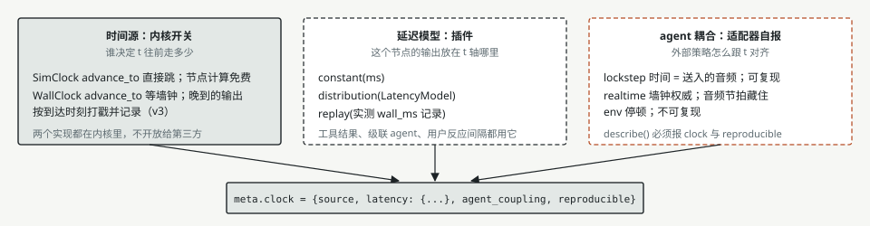
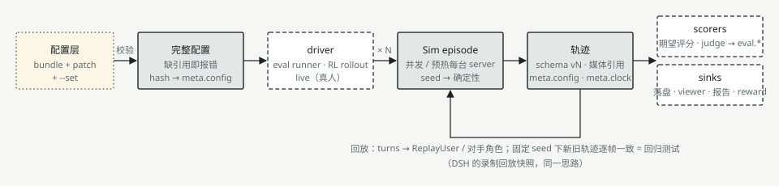

# InteractionGym architecture: a kernel and plugins

Status: design adopted 2026-10-24 on branch `plugin-arch`; step 1 of the migration (registry, layered configuration,
`ig run`) is implemented. The figures are in `docs/figures/` (the same pictures, light theme).

The kernel does one thing: it moves timestamped frames between nodes on a deterministic simulated clock and writes
everything that happened into a trajectory. Roles, behaviours, backends, tools, tasks, scorers, sinks and the way
episodes are organised are plugins, composed from layered configuration. Changing a benchmark is changing a layer of
configuration, not code.

The shape follows DeepSeek Harness ("everything is a plugin", see §9): a plugin is a module with a name, its
requirements, a validated config and a factory; services are reached by key; a run is composed from YAML layers
patched by row id; misconfiguration fails at load time. What is *not* taken from it is as important: inside an
episode there is no event bus and no middleware chain, because the order in which things happen inside an episode is
the determinism we sell.

## 1. Layers



| Layer | What it is | Who writes it |
|---|---|---|
| user patch | `ig run fdb3 --patch my.yml --set controlled.chunk_ms=100`: replaces rows by id | whoever runs an experiment |
| benchmark bundle | `fdb2`, `fdb3`, `audiomc`, `tau`, ...: pins the task source, roles, behaviours and their rates, scorers, agent spec | the benchmark's author |
| core bundle | opinionated defaults: roles `user` / `agent`, the standard expectation table, the default behaviour library, backends, latency model | the repo |
| plugins | one of the kinds below, with two or more implementations each | anyone; third parties through entry points |
| kernel | `Sim`, `Frame` / `Segment` / `Chunk`, the information boundary, the trajectory format, the clock source | the repo, rarely |

The three configuration layers resolve to **one complete configuration** (`ig run ... --dump-config` prints it),
which is written into every episode's `meta.config` with its digest. A run is reproducible from that file alone.

## 2. Inside an episode



Inside an episode there is exactly one kind of communication: a `Frame` on a named stream. A node sees a stream
because it subscribes to it; that subscription *is* the information boundary (`world.state` goes to the observer and
the user simulator, never to the controlled role). Segments are sliced at the current time, so no reader sees content
that has not been played yet.

Roles are symmetric. The **controlled** role is the one an external policy plays; its only distinction is that its
policy lives outside the `Env` and is driven every `chunk_ms` through `Env.step`. `user` and `agent` are the core
bundle's two preset roles, not kernel concepts. Any role may be controlled (DESIGN.md §5.1: user-side training,
three-party tasks); several controlled roles at once is deferred until real-human data can anchor self-play.

## 3. A role



A role has four slots — identity (persona, goal, SOP, hidden preferences), the streams it perceives and speaks on, a
voice, and a policy (`Simulated` | `Controlled` | `Replay`) — a core that schedules its turns, and a list of
**behaviour plugins** asked in a fixed order at each decision point (the other side's pauses, or every
`max_decision_gap_ms`). The first behaviour that wants to act wins; cross-behaviour budgets (frequency caps) and the
rng (one per role, dealt by the `Sim`) stay in the core, so two behaviours that want to fire at once resolve the same
way every time.

A behaviour plugin provides five things: **when** it fires (an event process on the given rng), **what** happens (a
sound, a line, silence), its effect on the **role itself** (cutting its own turn, pausing), its **labels** (`kind`,
`label`, `intent`) and the **expected reaction** of the other side (`expects`). The last one is what makes scoring
extensible: a new behaviour brings its own expectation, the scorer only looks the label up in the expectation table.
The table is keyed by (speaker role, listener role): a user may overlap the agent, the agent may not overlap the user
(`eval.reply_score`), so standards differ per pair.

The SOP machinery is a package that serves three seams rather than a seam of its own: it gives roles an identity
source (an SOP tree rendered as instructions; `sop.render`'s formats already form an entry-point registry,
`interaction_gym.sop_formats`), scorers a judge (`sop_task`: LLM extraction + rules on the tree) and the task seam
its cases. Tool calling is the same shape: `tool` is the seam, τ-bench / AutomationBench / SOPBench are provider
packages.

## 4. The clock



"Is the clock a plugin?" splits into three questions with three owners:

| Question | Owner | Implementations |
|---|---|---|
| Who decides how far `t` advances? | kernel switch | `SimClock` (today: `advance_to` jumps, node compute is free) and `WallClock` (v3: `advance_to` waits for wall time; late outputs are stamped when they arrive and recorded) — both in the kernel, not an open plugin point |
| Where on the `t` axis does an output land? | `latency` plugin | constant, distribution (`LatencyModel`), replay of measured `wall_ms` |
| How does the external policy align with `t`? | the agent adapter, declared | `lockstep` (time = the audio sent; reproducible) / `realtime` (wall clock authoritative; the env's stalls hidden by audio pacing; not reproducible); `describe()` must report `clock` and `reproducible` |

All three go into `meta.clock = {source, latency, agent_coupling, reproducible}`. One constraint to state up front:
under `WallClock` the user simulator's real compute time becomes the user's reaction delay, so wall-clock mode
requires a human or a pre-rendered replay on the user side, not an LLM computing live. For now only the field and the
interface are defined; `WallClock` is implemented with v3.

## 5. A run



Layers → one resolved configuration (validated: every plugin exists, every config field is known, every requirement
is met; its digest goes into `meta.config`) → a **driver** (an evaluation runner, an RL rollout, a live session) runs
N episodes → each episode's log is saved as a versioned trajectory → **scorers** add `eval.*`, **sinks** write files,
viewer pages, reports. The trajectory is the only hand-over; scorers and sinks read nothing else. A trajectory replays
into a `ReplayUser` or an opposing role: with a fixed seed the new trajectory must equal the old one frame for frame,
which is the regression test of every migration step (and the same idea as DSH's recorded-session snapshots).

## 6. Plugin kinds (seams)

A seam is complete only with an interface, **two or more implementations** and a consumer. Something with one
implementation is not made a plugin.

| Kind | The question the interface answers | Implementations (existing or planned) | Consumer |
|---|---|---|---|
| `role` | who am I, what do I perceive and speak, when do I decide to speak, how should my utterances be treated | `controlled` (external policy), `replay`, `user` (LLM / script simulator); planned: `business` (an LLM following an SOP), `observer` (a read-only judge) | `Sim`, scorers, `meta.roles` |
| `source` | what a simulated role says next | `script`, `llm`, `audiomc_script`, `audiomc_replan`; fdb2's examiner and fdb3's user source next | `role/user` |
| `behaviour` | when, what, effect on self, labels, expected reaction | barge_in · backchannel · aside · noise · called_away · third_party · response_delay (today inside `UserSim`; split in step 4) | the role core |
| `backend` | one LLM / TTS / ASR / judge call | `chat`, `tool_chat`, `tts`, `asr` (vLLM-compatible or hosted OpenAI), `fake_chat`, `tts_fake`; `Cached` as a wrapper | a role's source / voice / listener, the cascaded agent, judge scorers |
| `tool` | one tool call: schema, execution, world state, latency | `functions`; `TauBackend`, fdb3 `MockAPIBackend`, AutomationBench's four sets, SOPBench's domain functions, BrowserGym / OpenApps (to be registered) | `node/tool_world` executes and advertises them in the session; the agent emits `tool.call` |
| `agent` | how the external policy attaches to the controlled role | `canned`, `vllm_omni`, `openai_realtime`, `cascaded`; an RL framework's policy | the driver, through `Controlled` |
| `task` | where the episodes come from | `inline`, `jsonl`; fdb2 · fdb3 · audiomc · tau · sopbench · browsergym · colbench · openapps (to be registered) | the driver, bundles |
| `scorer` / `sink` | read one trajectory → `eval.*` / a side effect | `interaction`, `timing`, `fdb3_quick`; `jsonl`, `html`, `agent_traces`, `stdout`; SOP judge, content judges (to be registered) | the driver, after each episode |
| `report` | post-hoc scoring of a whole run from its files: judges, tables, pages | `audiomc`, `fdb2`, `fdb3` (`interaction_gym.benchmarks.reports`, the code the scripts' `report` commands run) | `ig report` |
| `driver` | how episodes are organised | `eval` (concurrency, resume, retries, warm-up, A/B `arms` sharing a cache per (task, seed)); RL rollout (fork, logprobs), live | `ig run` |
| `latency` / `mixer` | where an output lands on `t` / how concurrent segments of one stream combine | constant · distribution · replay / audio mix (`core._mix` today) · text interleave · video overlay | nodes, `Sim` delivery |

### How a plugin is written

```python
from dataclasses import dataclass
from interaction_gym.plugins import plugin

@dataclass
class EchoConfig:
    prefix: str = "You said: "   # every field is a config key; unknown keys and missing required ones fail at load

@plugin("agent", "echo", requires=("controlled",), config=EchoConfig)
def echo(ctx, cfg: EchoConfig):
    """Repeats the user (the first docstring line is what `ig plugins` shows)."""
    spec = ctx["controlled"].spec          # objects of the rows it requires, by row id or service key
    return lambda seed: EchoAgent(spec, cfg.prefix)
```

- `requires` names services (row ids, or keys a row's plugin `provides`, such as `controlled`); those rows are built
  first. Config fields that name other rows are declared as `refs` (`refs={"source": ("script",)}`), so the resolver
  checks them and orders the build; a value that is neither a row id nor an allowed literal is an error.
- A plugin without a `Config` receives the config dict as keyword arguments (the thin wrappers around server
  adapters work this way: the adapter's signature is the contract).
- A `role` / `node` / `source` plugin returns a shared object (a `Node` keeps its state in `init_state`'s state, as
  the kernel requires) or a factory `(EpisodeContext) -> object` when the object keeps per-episode state on itself;
  the run builds factories afresh for every episode. A `task` plugin returns tasks, or a task source with `tasks()`,
  `prepare(task, ep)` (the episode's view of a task) and `build(...)` (a preparation stage run by `ig prepare`).
- Third-party packages register plugins with an entry point in the group `interaction_gym.plugins` pointing at a
  module that imports and registers them.

### How a run is configured

```yaml
# a bundle: a YAML list of operations; the first may extend another bundle
- extends: core
- insert:
    - {id: user, plugin: role/replay, config: {stream: user.speech, turns: [{t: 0, text: "Hi"}]}}
    - {id: agent, plugin: agent/canned, config: {replies: ["Hello"]}}
    - {id: tasks, plugin: task/inline, config: {tasks: [{id: t1}]}}
- id: env                      # a patch: `config` replaces the row's WHOLE config (no merging)
  config: {max_ms: 60000}
- id: viewer
  disabled: true
```

`ig run <bundle> [--patch f.yml]... [--set row.key=value]... [--out DIR] [--seeds 0,1] [--dump-config]`. `--set` is
the one merging operation (one key inside a row's config). `ig plugins [kind]` lists what can go in a row with each
plugin's config fields; `ig bundles` lists the built-in bundles.

## 7. Kernel rules

1. **Anything a role sees can be rebuilt from the trajectory.** A new visible input needs a frame in the log
   (DSH: "model-visible means logged").
2. **Plugins use only the rng the `Sim` deals them and never read the wall clock.** Same seed, same configuration,
   same trajectory frame for frame. Realtime-coupled agents are the exception and must report `reproducible=false`.
3. **No hard-coded tunables in plugins.** A choice that varies by deployment is a config field; a wrong configuration
   fails at composition time, never silently.
4. **Inside an episode, only frames.** The composition layer has services and may grow hooks; the episode has no
   event bus. The few decision points are arbitrated explicitly by the role core.

## 8. Migration order and acceptance

Each step's acceptance is: with a fixed seed, the trajectories before and after are identical frame for frame.

1. **Registry, layered configuration, `ig run`, `--dump-config`** — done. Existing classes are wrapped, not changed.
   `tests/test_plugins.py` builds the same episode through the composition and by hand and compares the logs.
2. **The benchmark runners move onto `driver/eval`**, each benchmark a bundle; the runners' shared concurrency,
   retry, warm-up, resume and A/B code lives once, in the driver. **audiomc done** (bundles `audiomc`,
   `audiomc_cascaded`), **fdb2 done** (`fdb2`, `fdb2_confirm`, `fdb2_cascaded`; `ig prepare` for its reference
   scripts), **fdb3 done** (`fdb3`, `fdb3_natural`, `fdb3_duplex`), and **2b done**: the scripts' `report`
   commands moved into `interaction_gym.benchmarks.reports` (verbatim) and run as `report/*` rows through
   `ig report <bundle> --out DIR`; the scripts' `report` subcommands call the same functions, and the tests check
   that both write identical `rows.json` / `summary.md` on one run. Every migrated runner gets a parity check against
   its script on `main`:

   | `examples/audiomc_ab.py run` on main | now | checked by |
   |---|---|---|
   | `audiomc.load(data, only, per_axis)` | `task/audiomc` | `test_plugins_audiomc` |
   | condition A: `benchmark_user(audiomc.ScriptSource(), Voice(), TurnTaking(response_delay=ResponseDelay(), yield_after_ms=None, nudge_after_ms=10000))` | row `user` (`role/user`, `source/audiomc_script`, `benchmark: true`) | A episode equals the hand-built one frame for frame |
   | condition B: `ReplanSource(llm(seed, 0.7, 600))`, voice cloned from the first recording with a plain-TTS fallback | arm B patch: `source/audiomc_replan`, `backend/clone_fallback`, `backend/chat` with `defaults` and `seed: episode` | B episode equals; the replanning call carries the episode seed |
   | `Env(max_ms=900_000, end_idle_ms=8000)`, `duplex_spec(name, SR)` / `CASCADED_SPEC` | rows `env`, `controlled` (`preset: minicpmo`; `audiomc_cascaded` sets `chunk_ms: 100`) | dump-config |
   | `make_agent`: `VllmOmniDuplexAgent(duplex_spec, AGENT_URL, audio_out, **duplex_model(name), out_sr, clock="input", trace_tokens, session.instructions)`; `CascadedAgent(..., ToolChat(native=False, max_tokens=300), voice="aiden", Endpointing(silence_ms=800), LatencyModel(), seed, cache)` | `agent/vllm_omni` (`preset`, `instructions`); `agent/cascaded` in `audiomc_cascaded` | signatures unchanged; constructed in tests with fakes |
   | `--agent gander / personaplex`, `--audio-out` | `--set agent.preset=... --set controlled.preset=...`, `--set agent.audio_out=true` | bundle header |
   | A and B of one (task, seed) share the cascaded agent's call `cache` | `EpisodeContext.cache` shared across arms | test: same cache object in both arms |
   | resume: skip episode ids already in `out/<tag>/<cond>/episodes.jsonl` | the jsonl sink's `done()`, per arm | second run: "0 pairs to run" |
   | `check_output_mode` (never append audio-output episodes to a text-only file) | driver, from the factory's `audio_out` | test raises `ValueError` |
   | warm-up: one throw-away episode per server behind `IG_AGENT_URL` | `driver.warmup`, `servers_behind(factory.url)` | code path; servers not reachable in tests |
   | `--retries` with 45–75 s waits, "GAVE UP" | `retries`, `retry_wait_s`, `retry_jitter_s` | test: two failures then success |
   | meta: `run_id`, `agent` (describe + name), `condition`, `agent_name`, `agent_base`, `task_id`, `wall_s`; agent traces to `agent_traces.jsonl` | the driver writes them (`agent_base` is `meta.agent.name`, the agent row id); `sink/agent_traces` | the script's `report` runs unchanged on a bundle run |
   | progress line with ep/h and the agent's final reply | ep/h, user turns, scores | — |
   | `report` (rubric judge, validity, timing tables, consistency, bootstrap CIs) | `report/audiomc` (`ig report audiomc`) | identical `rows.json` / `summary.md` from the script and the plugin |

   | `examples/fdb2_ab.py` on main | now | checked by |
   |---|---|---|
   | `prepare`: one agent-free script per (task, seed) — `fdb2.make_script(task, llm(seed), llm(seed+10000), 12)`, examiner lines rendered once with `Voice(tts, voice="serena", clone=clone_tts())`, `fdb2.schedule`, `script.json` + `eNN.wav` under `<out>/scripts/<task>/s<seed>` (or `--scripts`); 4 attempts with 20–40 s waits | `ig prepare fdb2`: `task/fdb2.build` (the task source's preparation stage); `backend/chat` rows `examiner_llm` (`seed: episode`) and `reference_llm` (`seed_offset: 10000`); `tasks.scripts` | `test_plugins_fdb2`: same files, fields, schedule; a second prepare writes nothing |
   | A: `ReplayUser(voice=Voice())` on the script's examiner lines with `t < A_MAX_MS` (`final` on the last), `max_ms = min(script_end + 15 s, A_MAX_MS)`, `end_idle_ms=8000` | `task/fdb2.prepare` for the arm mapped to `replay`: sets `scenario.turns`, `ep.env.max_ms`; env row `end_idle_ms: 8000` | A episode equals the hand-built one frame for frame |
   | B: `benchmark_user(fdb2.ExaminerSource(llm(seed), 12, closing), Voice(tts(), voice="serena", clone=clone_tts()), TurnTaking(response_delay=ResponseDelay(), yield_after_ms=1000, nudge_after_ms=10000))`, `scenario.first_turn` = the script's first line, `max_ms=MAX_MS`, `end_idle_ms=3000` | arm B patch: `role/user` with `source/fdb2_examiner`, the env row with `end_idle_ms: 3000`; `prepare` for the arm mapped to `live` sets `first_turn` | B episode equals |
   | one `ExaminerSource` per episode (its `log`, the `StageClosing` counters) | roles and sources may be per-episode factories (`role/user`, `source/fdb2_examiner`); `make_env(ep)` builds them | two episodes, two examiners: equal logs |
   | `--closing` (`fdb2.StageClosing(llm(seed, 0.0, 60))`) | `--set examiner.closing=true` with the `closing_llm` row | test: the tracker runs, `meta.closing` |
   | `--max-ms`, `--a-max-ms` | `tasks.max_ms` + `env.max_ms`, `tasks.a_max_ms` | config |
   | `--limit N`: every k-th task (a spread over the splits) | `driver.limit_stride: true` | test: `--limit 2` picks tasks `[::2]` |
   | agents `minicpmo` (official examinee prompt), `minicpmo-confirm`, `gander`, `personaplex`, `cascaded` | `instructions: !py interaction_gym.benchmarks.fdb2:EXAMINEE_PROMPT`; bundles `fdb2_confirm`, `fdb2_cascaded`; `--set agent.preset=gander --set controlled.preset=gander` | `!py` resolves and is recorded expanded |
   | task reloaded per episode (its scenario was mutated) | `prepare` deep-copies; the run's task stays untouched | test |
   | meta: `run_id=fdb2-ab-<tag>`, `agent`, `agent_events`, `condition`, `agent_name`, `agent_base`, `task_id`, `wall_s`, `max_ms` (A: `A_MAX_MS`, B: `MAX_MS`), `closing`, `examiner_log` (when non-empty); agent traces | the driver (`agent_events` from `agent.events`, `examiner_log` / `closing` from the source's `episode_meta()`, `max_ms` / `closing` for A from `prepare`); `sink/agent_traces` | the script's `report` runs unchanged on a bundle run |
   | warm-up on the first job's A script; resume; `check_output_mode`; retries; shared cache | as for audiomc (the driver) | audiomc tests |
   | `report` (official judge, TT / IF / task tables, A = B consistency, coherence, pacing, cap diagnosis) | `report/fdb2` (`ig report fdb2`) | identical `rows.json` / `summary.md` from the script and the plugin |

   | `examples/fdb3_ab.py run` on main | now | checked by |
   |---|---|---|
   | `fdb3.load(data, only)` (one task per recording, `profile.language=en`), `--limit` first N | `task/fdb3` | `test_plugins_fdb3` |
   | A: `ReplayUser(voice=Voice())` + `ToolWorld(MockAPIBackend(), fdb3.latency_ms(task))`, `max_ms = user_end_ms + 60 s`, `end_idle_ms=3000` (8000 for duplex, no tools) | `role/replay`; `tool/fdb3_mock` + `node/tool_world` with `latency_by_task` (a world per episode); `task/fdb3.prepare` sets `ep.env.max_ms`; `fdb3_duplex` disables the tools row and sets `end_idle_ms: 8000` | A episode equals the hand-built one frame for frame, for both latency profiles |
   | B: `benchmark_user(fdb3.UserSource(llm(seed, 0.7, 200), 8), Voice(clone, clone=clone), TurnTaking(response_delay=ResponseDelay(), yield_after_ms=None, nudge_after_ms=10000))`, `max_ms=180 s`, `end_idle_ms=3000` | arm B patch with `source/fdb3_user`, `backend/clone_fallback`; `prepare` sets `max_ms` | B episode equals |
   | `SPEC = AgentSpec(100 ms, obs=(user.speech, tool.result), audio)` / `duplex_spec` | row `controlled` (`obs: [user.speech, tool.result]`; `preset` in `fdb3_duplex`) | config |
   | cascaded agents: `ToolChat(native=False, max_tokens=512)`, `Endpointing(silence_ms=--endpoint-ms)`, prompts `cascaded-official` (`fdb3.AGENT_INSTRUCTIONS`) / `cascaded-natural`; tag suffix `-ep<ms>` | `agent/cascaded` with `!py interaction_gym.benchmarks.fdb3:AGENT_INSTRUCTIONS`; `fdb3_natural`; `--set agent.endpointing.silence_ms=600 --tag cascaded-official-ep600` | the composed agent's `describe()` (`endpointing.silence_ms`) |
   | duplex agents: `session.instructions = DUPLEX_PROMPT.format(domain=DOMAINS[benchmark.domain])` per task | `agent/vllm_omni` `instructions` template + `instructions_vars` (`path`, `map`, `default`) | test: the prompt names the recording's domain, the default for an unknown one |
   | `ep.eval.benchmark = quick_metrics(ep)` (calls, `u1_ms`, timing vs the request's end, user turns) | `scorer/fdb3_quick` as row `benchmark` | test: same keys, same calls as the hand-built episode |
   | meta: `run_id=fdb3-ab-<tag>`, `agent` (+ `url`, `system_prompt` for duplex), `agent_events`, `condition`, `agent_name` (the agent's name; the folder is the tag), `recording`, `wall_s`; agent traces | the driver (`agent_name` is the tag — identical unless a `-ep` suffix is used; the report does not read it); `task/fdb3.prepare` sets `recording`; `sink/agent_traces` in `fdb3_duplex` | test |
   | A and B share the cascaded agent's cache; resume; `check_output_mode`; warm-up (duplex); retries 6 | the driver | audiomc tests |
   | `report` (pass@1, corrections, timing, pages) | `report/fdb3` (`ig report fdb3 --tag <tag>`; `interaction_gym.benchmarks.reports.fdb3`, also what the script's `report` runs) | identical `rows.json` / `summary.md` from both |

   The `report` rows of audiomc and fdb2 are the same shape (`report/audiomc`, `report/fdb2`; the shared judge,
   validity and timing tables in `interaction_gym.benchmarks.reports`). What stays in the example scripts is the
   command-line surface and the `prepare` / `run` loops they always had.

   Found by the parity tests so far: `response_delay: {}` dropped as falsy; the kernel deals each node its rng in
   the order nodes are given, so a bundle must keep the scripts' node order (`{"user", "tools"}`) — rows now keep
   their layer order through dump and reload (the build order is only for requirements). A kernel that seeded nodes
   by name instead would remove this dependence; it would change every existing trajectory, so it waits for a format
   version bump.
3. **Role table and expectation table** — the table is done ([ROLES.md](ROLES.md)): `turns[].role` is a role name
   (the stream's first segment; `policy.*` stays `agent`), `meta.roles` / `meta.controlled` are recorded, and every
   reader (`eval.scores` / `duplex`, `interaction`, `turn_validity`, the SOP transcript, the viewer) judges relative
   to the controlled role; old files read as `controlled = agent`. `role/controlled` takes any `name` (its `out`
   must agree). `tests/test_roles.py`: a renamed controlled role gives the same timeline and scores as the default
   names; the sides swapped (the policy as the user); a three-role bundle. Deferred (ROLES.md §6): the expectation
   table keyed by (speaker, listener) — it comes with step 4 — several controlled roles, tool callers by role.
4. **Split `UserSim`** into the role core (scheduling, arbitration, budgets) and behaviour plugins. The largest
   change; it goes behind the regression net of steps 1–3.
5. **Clock fields.** `meta.clock` and the time-source interface only; `WallClock` with v3.

## 9. Relation to DeepSeek Harness

Taken: plugin = module with `name` / `requires` / `Config` / `apply`; services by key; load order from requirements,
never from row order; bundles layered by patches that replace a row's config by id; configuration validated at load;
`--dump-config`; recorded replay as regression testing; an auto-generated hook / event table checked against the
code (to add when the composition layer grows hooks).

Not taken: the event bus and waterfall middleware *inside* the episode (order by registration would break
determinism); hot reload and reversible effects (batch simulation does not need them); vendoring a framework (a few
hundred lines of registry and loader suffice); the scale (159 plugins and 30 gates are what a product with a plugin
market needs). Role symmetry does not exist in DSH (one agent acting on the world); it is our own design.
